# CBE DS-300 → ESPHome touch panel

Replace the **CBE PC-100 / PC-200 / PC220** control panel of a motorhome with a **10.1" ESP32-P4 touch screen** running **ESPHome + LVGL** and **Home Assistant**. The **CBE DS-300** distribution unit stays where it is, untouched: the new panel plugs into the same 16-pin cable (connector 17) through a 3D-printed plug.

This repo has the **reverse-engineered pinout of DS-300 connector 17**, the small interface that switches the 12 V loads and the water pump from the screen, the complete firmware, and the 3D-printed parts. Everything here is the setup that runs every day in the author's van. Nothing is untested theory.

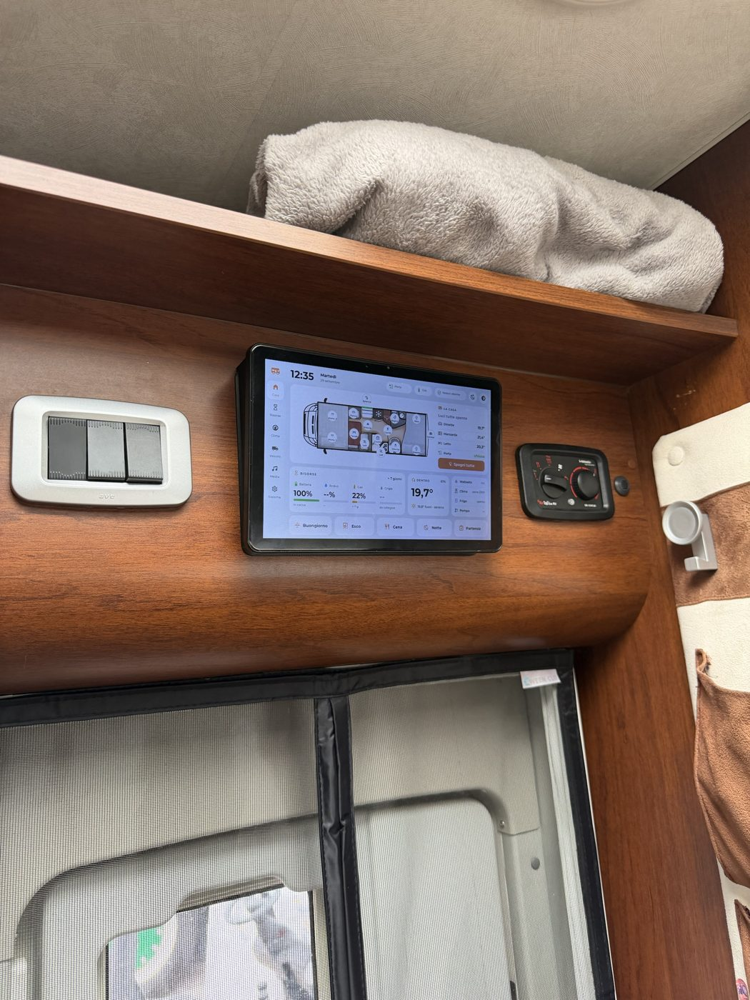
*The panel where the CBE PC220 used to be (light theme, home page). The Webasto knob on the right is still the original one.*

> ⚠️ You are working on the 12 V system of a vehicle. Read the [disclaimer](#disclaimer) first.

---

## Contents

- [What you get](#what-you-get)
- [Vehicle](#vehicle)
- [How it works](#how-it-works)
- [Connector 17 pinout](#connector-17-pinout)
- [Shopping list](#shopping-list)
- [Step-by-step build](#step-by-step-build)
- [Firmware](#firmware)
- [The screens](#the-screens)
- [Switching the 12 V from the screen](#switching-the-12-v-from-the-screen)
- [Webasto (optional, not done here)](#webasto-optional-not-done-here)
- [Engine and tyres: related projects](#engine-and-tyres-related-projects)
- [Gotchas](#gotchas)
- [Contributing](#contributing)
- [Disclaimer](#disclaimer)
- [How this was made](#how-this-was-made)

## What you get

**main 12 V switch (PIN protected) · water pump switch · inside / outside temperature from the original CBE probes · grey-water tank full · 15 lights on a real floor plan · battery, water, gas and grey water with days-left estimates · climate · engine, tyres and spirit level · media player · alarms banner · checklist before leaving · night clock · light / dark theme · everything also in Home Assistant**

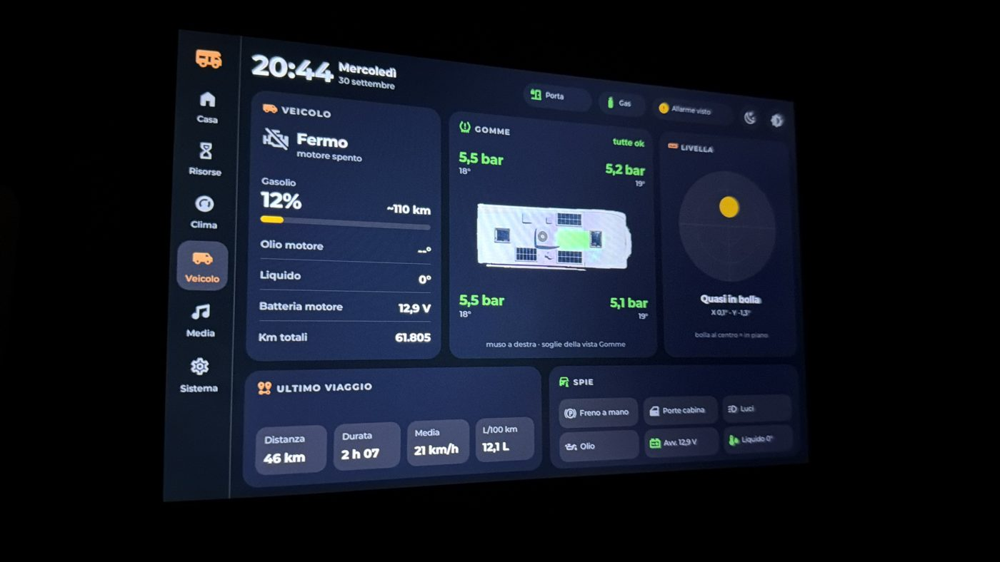
*Vehicle page at night (dark theme). Engine data come from a [WiCAN](https://github.com/danderik88/fiat-ducato-x250-wican), tyres from a [USB TPMS dongle](https://github.com/danderik88/usb-tpms-home-assistant).*

## Vehicle

| | |
|---|---|
| Motorhome | **Elnagh Prince 55L** (2009), Fiat Ducato X250 base |
| Distribution unit | **CBE DS-300/E** (Elnagh variant, manual "DS300-EL") |
| Original panel | **CBE PC220** (same connector as PC-100 / PC-200) |
| New panel | **Guition JC8012P4A1C**, ESP32-P4 + ESP32-C6, 10.1" 1280×800 IPS, capacitive touch |
| Firmware | ESPHome **2026.6.4**, LVGL 9 |

Other motorhomes with a CBE DS-300 and a 16-pin panel cable are likely the same, but only the van above has been tested.

## How it works

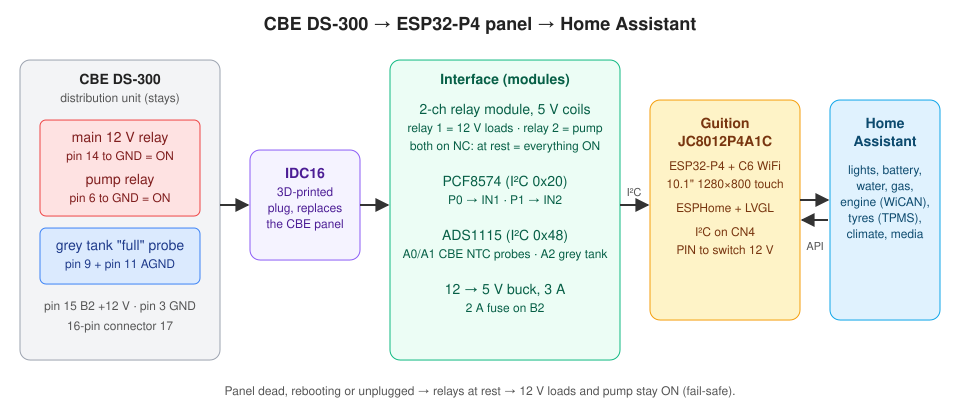

- The CBE panel is **only a remote control**. The DS-300 holds the relays and fuses; the panel closes a few command lines and reads levels over connector 17.
- The two commands that matter, **C.GEN** (main 12 V loads: lights, sockets, boiler) and **C.POMPA** (water pump), are **active-low**: tie them to **GND** and the DS-300 switches that line on. Nothing else is needed: no pulses, no data protocol.
- The new panel does it with a **2-channel relay module on the NC contacts**. At rest (panel off, rebooting, dead) the NC contacts are closed, so **loads and pump stay ON**. The panel energises a relay only to switch something OFF.
- The relays are driven by a **PCF8574** and the probes are read by an **ADS1115**, both on the I²C connector of the panel (CN4). No GPIO soldering on the board.
- Everything else (lights, battery, water, gas…) comes from **Home Assistant** over WiFi.

## Connector 17 pinout

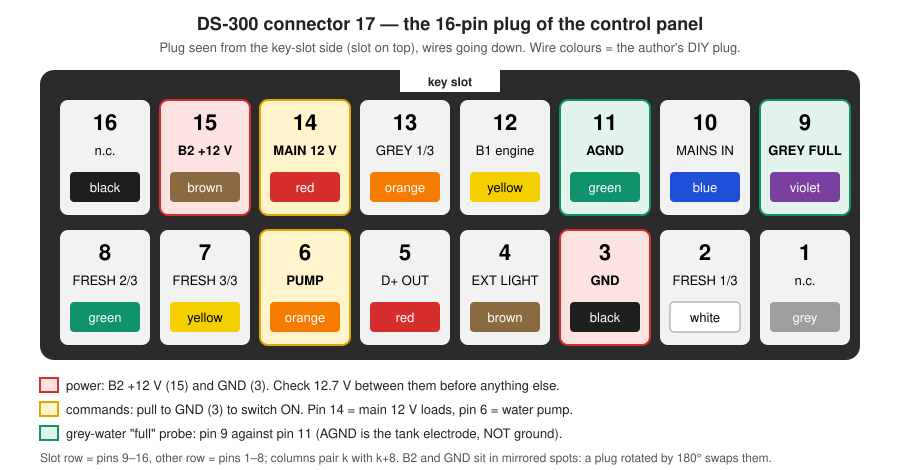

| Pin | Signal | Used here | Notes |
|---|---|---|---|
| 15 | **B2** +12 V (service battery) | ✅ power | always on, ~12.7 V (13.5 V on charge) |
| 3 | **GND** | ✅ | |
| 14 | **C.GEN** main 12 V loads | ✅ relay 1 | to GND = ON |
| 6 | **C.POMPA** water pump | ✅ relay 2 | to GND = ON |
| 9 | REC 3/3 grey tank full | ✅ ADS1115 A2 | passive probe, measured against pin 11 |
| 11 | AGND | ✅ ADS1115 GND | the tank electrode, **not** ground (open circuit to pin 3) |
| 13 | REC 1/3 grey tank ⅓ | – | not fitted in the author's tank |
| 2 / 8 / 7 | POT 1/3, 2/3, 3/3 fresh water | – | water level comes from Home Assistant |
| 5 | OUT D+ | – | |
| 10 | S.RETE mains present | – | |
| 12 | B1 engine battery | – | |
| 4 | R.L.EXT outdoor light relay | – | |
| 1, 16 | not connected | – | |

**Geometry**: two rows of 8. The row on the **key-slot side is 9–16**, the other row is 1–8, and columns pair `k` with `k+8`. The pin names come from the official CBE wiring diagram *DG01UK01.A* (PC-100/PC-200/DS-300) and were checked on the real van one by one with a multimeter and by switching the relays.

**How it was confirmed**

1. **12.7 V between pin 15 and pin 3** with everything off: that pin pair also tells you the plug orientation.
2. **Pin 14 straight to pin 3** with a wire: the main relay clicks and the lights work.
3. **Pin 6 straight to pin 3**: the pump relay clicks and water flows.

## Shopping list

| Part | Qty | Notes |
|---|---|---|
| **Guition JC8012P4A1C** (ESP32-P4, 10.1") | 1 | WiFi via the on-board ESP32-C6 |
| **12 → 5 V buck converter, USB-C, 3 A** | 1 | the author uses a potted 8–32 V → 5 V 3 A one. The panel needs the full 3 A |
| Inline mini-blade fuse holder + **2 A** fuse | 1 | on the +12 V from pin 15 |
| **PCF8574** I²C module | 1 | address 0x20 (A0 A1 A2 to GND) |
| **2-channel relay module, 5 V coils**, opto-isolated, **low-level trigger**, with a `GND · VCC · JD-VCC` header | 1 | the jumper between VCC and JD-VCC is removed. Modules with `DC+ / DC-` screw terminals and a High/Low jumper do **not** work with a PCF8574 |
| **ADS1115** module | 1 | address 0x48 (ADDR to GND) |
| Resistors: 2 × **10 kΩ 1%**, 1 × **100 kΩ** | 3 | NTC dividers, grey-tank divider |
| **JST SH 1.0 mm 4-pin** cable, one end loose | 1 | for CN4 of the panel |
| Small perfboard, female header for the ADS1115, Dupont wires | | |
| 16 × Dupont **male** crimp terminals + wire | | for the printed plug |
| PETG filament, M3 screw + heat-set insert | | plug and wall mount |

## Step-by-step build

### 1. Find pin 15 and pin 3

Unplug the old CBE panel. On the 16-pin cable, measure **~12.7 V between pin 15 (B2) and pin 3 (GND)**. If you read 0 V, the battery isolator is open or the B2 fuse is blown: fix that first. If the pins look swapped, the plug is rotated by 180°: B2 and GND sit in mirrored positions.

### 2. Print and wire the IDC16 plug

The cable from the DS-300 ends in a female 2×8 IDC socket. [`hardware/idc16-plug/spina_idc16.stl`](hardware/idc16-plug/spina_idc16.stl) is a male shroud for it: crimp **Dupont male terminals** on the wires and push them in from the back, lance facing outwards, until they click. A zip tie over the back holds the socket against vibration.

| | |
|---|---|
| 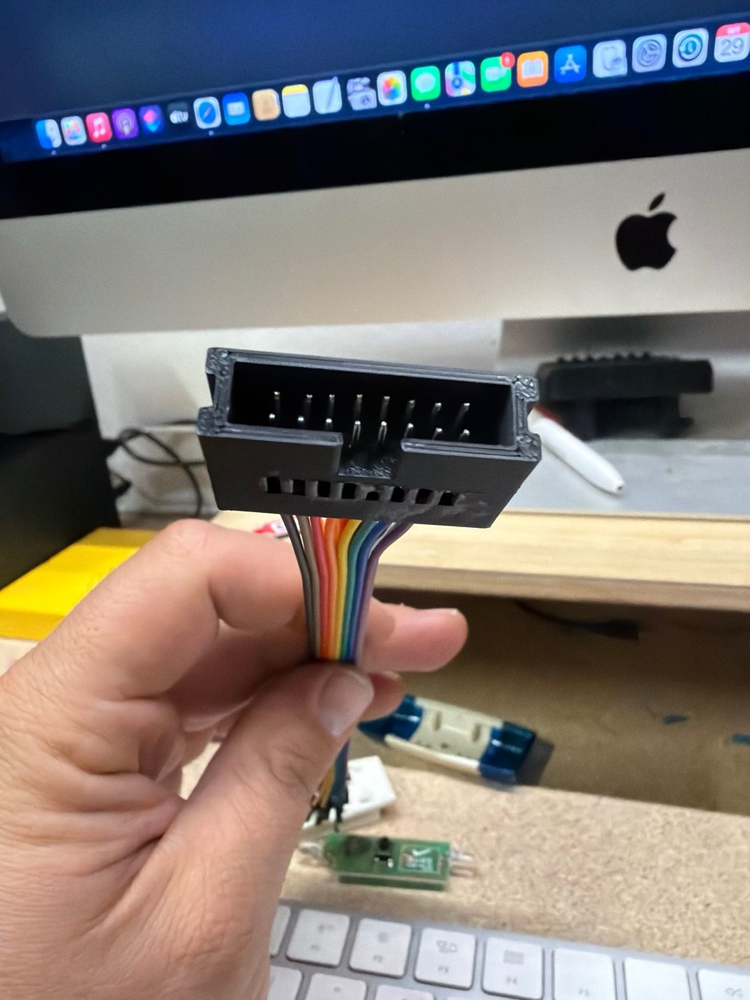 | 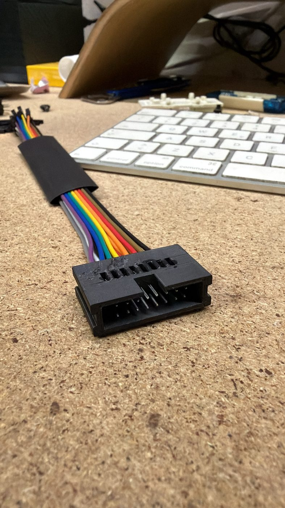 |

*The printed plug: the key slot on the shroud matches the bump of the IDC socket, so it only goes in one way.*

Only six wires are needed (pins 15, 3, 14, 6, 9, 11). The author wired all sixteen, for future use. The wire colours in the pinout picture are the ones of this plug, not of the van's cable.

Measure your IDC socket before printing: the parameters are at the top of [`connettore.py`](hardware/idc16-plug/connettore.py) (FreeCAD, `freecadcmd connettore.py` regenerates the STL and STEP).

### 3. Wire the interface

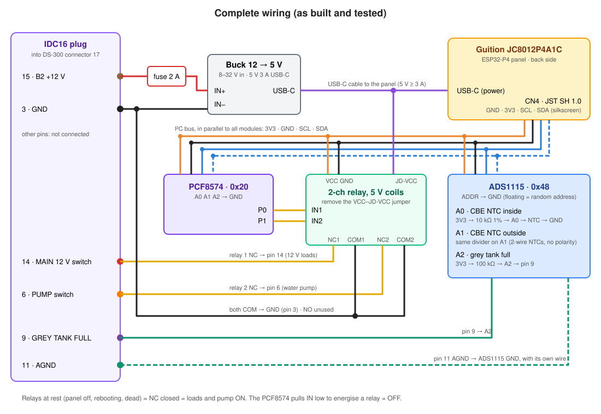

1. **Power**: pin 15 → **2 A fuse** → buck IN+, pin 3 → buck IN−. The buck's USB-C goes to the panel.
2. **5 V for the relay coils**: cut the USB-C cable open and tap red (5 V) and black (GND) towards the relay module's **JD-VCC** and **GND**. Re-join all four wires towards the panel.
3. **I²C bus** from CN4 of the panel (`GND · 3V3 · SCL · SDA`, follow the silkscreen labels, not the wire colours) to the PCF8574, the ADS1115 and the relay module (**VCC = 3.3 V** and GND only, the inputs side).
4. **Remove the VCC–JD-VCC jumper** on the relay module. With the jumper on and VCC at 5 V, the 3.3 V "high" of the PCF8574 does not fully turn the opto off and the relay can stay on.
5. **PCF8574**: A0, A1, A2 to GND (address 0x20). **P0 → IN1**, **P1 → IN2**.
6. **Relay 1**: COM → pin 3 (GND), **NC** → pin 14 (C.GEN). **Relay 2**: COM → pin 3, **NC** → pin 6 (C.POMPA). Leave NO free.
7. **ADS1115**: ADDR to GND with a wire (floating = random address).
   - A0 and A1: the two **original CBE NTC probes** (2 wires each, no polarity; they reach the panel directly, not through connector 17). Divider: 3V3 → 10 kΩ 1% → A0 → NTC → GND. The author's probes measure **B = 3950, R25 = 9.2 kΩ**.
   - A2: **grey tank full**. 3V3 → 100 kΩ → A2 → pin 9, and **pin 11 (AGND) → ADS1115 GND with its own wire**. Without it the probe has no return path.

The author put the ADS1115 and the four resistors on a small perfboard, one bus column per signal; the PCF8574 and the relay module stay outside on Dupont wires.

| | |
|---|---|
| 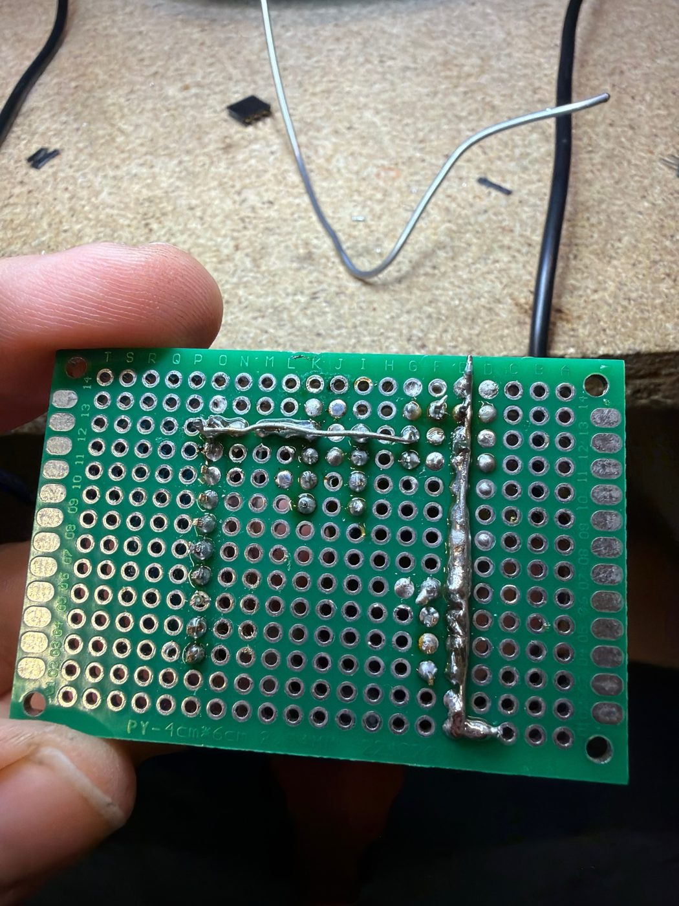 | 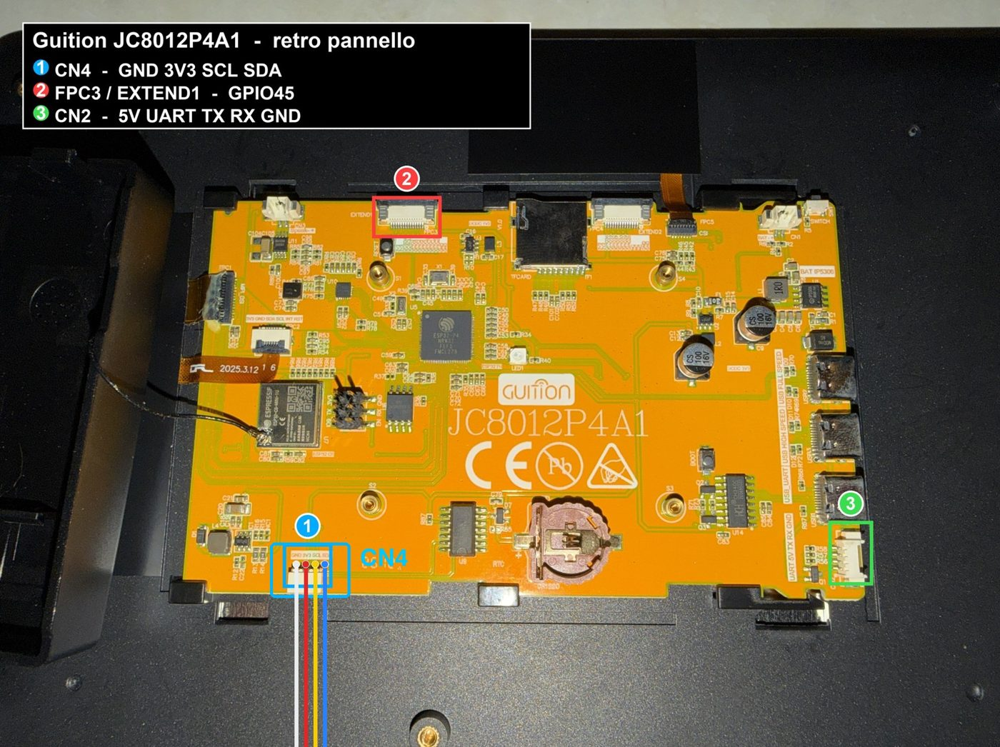 |

*Left: the perfboard, solder side (bus columns as bare wire). Right: back of the Guition board, CN4 is the small 4-pin connector at the bottom (the module boxes in this older picture are not up to date: follow the wiring diagram above).*

**Before plugging in**, with the relay module powered and the PCF8574 at rest: relay 1 NC must be closed (continuity between COM and NC).

### 4. Mount the panel

[`hardware/display-mount/`](hardware/display-mount/) is a two-part wall mount: a plate screwed to the six M2.5 bosses on the back of the display, and a wall bracket that covers the old panel cut-out (210 × 75 mm) with a 10° tilt. The plate hangs on French cleats and one M3 screw from below into a heat-set insert locks it. Print in PETG. Parameters and dimensions are in [`supporto.py`](hardware/display-mount/supporto.py).

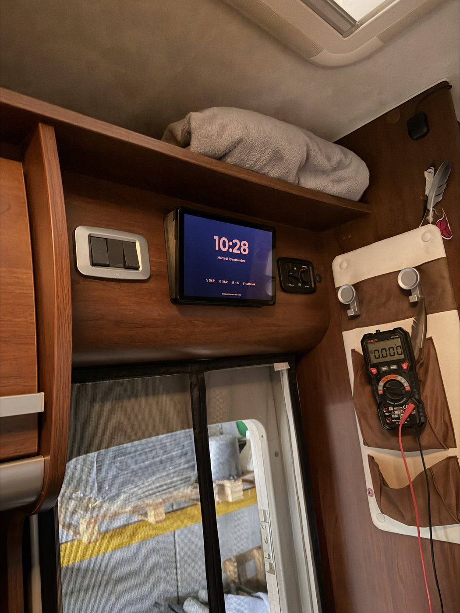
*Rest screen with the clock, after 30 s without touches.*

## Firmware

[`firmware/panel-p4.yaml`](firmware/panel-p4.yaml) is a single ESPHome file (~3800 lines, LVGL). Labels on the screen are in Italian; code and comments are mostly Italian too.

```bash
pip install esphome==2026.6.4
cp firmware/secrets.yaml.example firmware/secrets.yaml   # fill it in
esphome compile firmware/panel-p4.yaml
esphome upload  firmware/panel-p4.yaml --device <panel-ip>   # OTA, after the first USB flash
esphome logs    firmware/panel-p4.yaml --device <panel-ip>
```

- **First flash over USB**: hold **BOOT** while plugging the USB-C cable, otherwise the web flasher "succeeds" without writing and the Guition factory demo stays on.
- **Secrets**: WiFi, API key, OTA password, the **6-digit PIN** asked before switching the 12 V, and the Home Assistant URL (for the album cover).
- **Home Assistant entities**: the panel reads about 90 entities (lights, battery, water, gas, climate, tyres, engine…), listed in the `sensor:` / `text_sensor:` / `binary_sensor:` sections. **Replace the `entity_id`s with yours.** A missing entity does not crash anything: the value shows `--`.
- **Hardware entities** exposed to Home Assistant: "Utenze 12V" (relay 1), "Pompa acqua" (relay 2), "Temp interna / esterna (sonda CBE)", "Grigie piene", plus the `Reset utenze 12V` button (OFF → 3 s → ON).
- **Touch driver**: `firmware/components/gsl3680` is the GSL3680 component from [kvj/esphome `jd9365_gsl3680`](https://github.com/kvj/esphome/tree/jd9365_gsl3680), vendored with a small patch for ESPHome 2026.x.
- **Self-check** of the helper functions (autonomy estimates): `c++ -std=c++17 tools/test_ui_helpers.cpp -o /tmp/t && /tmp/t`.
- **Floor plan**: `firmware/images/plan_{dark,light}.png` is the Elnagh Prince 55L. Draw your own and move the light buttons in the `page_home` section.

## The screens

Design mockups of the UI (the firmware follows them; the photos above are the real thing).

| | |
|---|---|
| 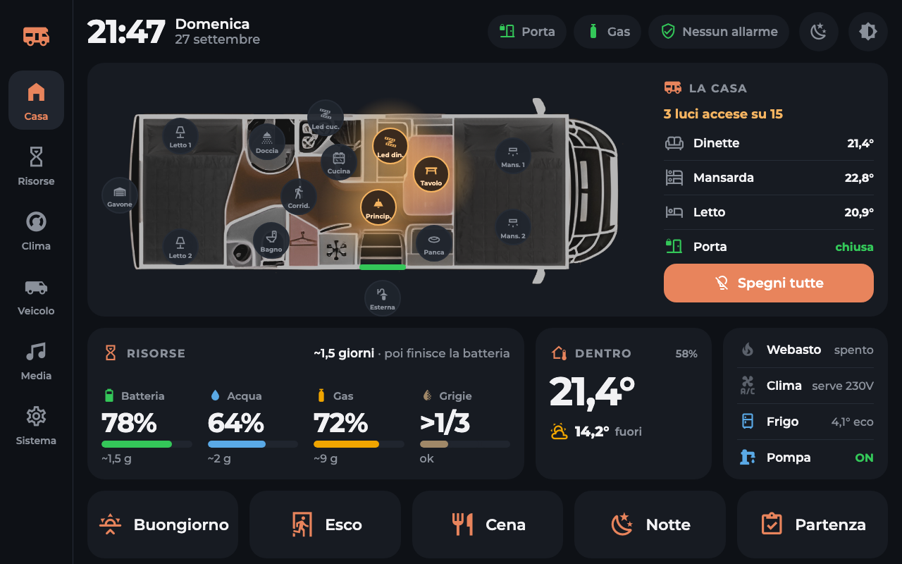 | 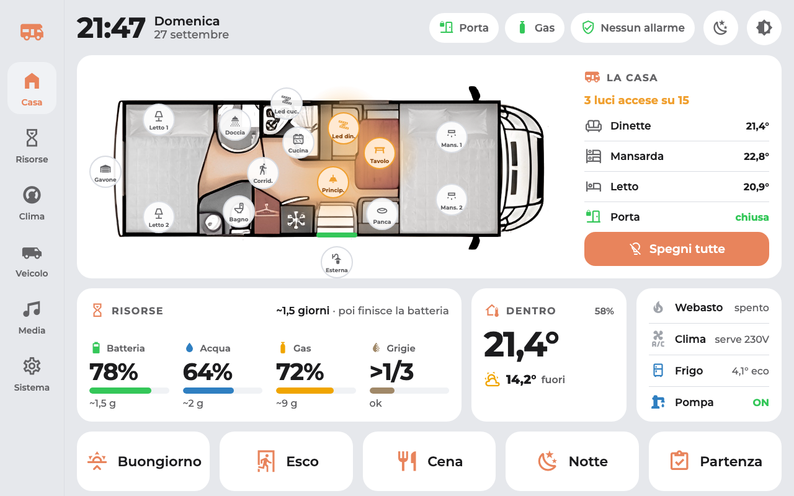 |
| *Home: floor plan with the lights, resources, inside temperature, scenes* | *Same page, light theme (switched by a lux sensor in Home Assistant)* |
| 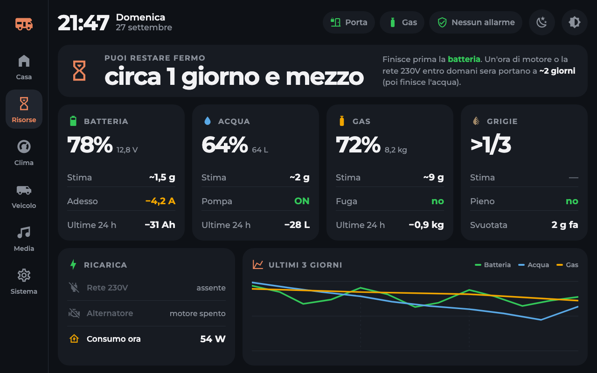 | 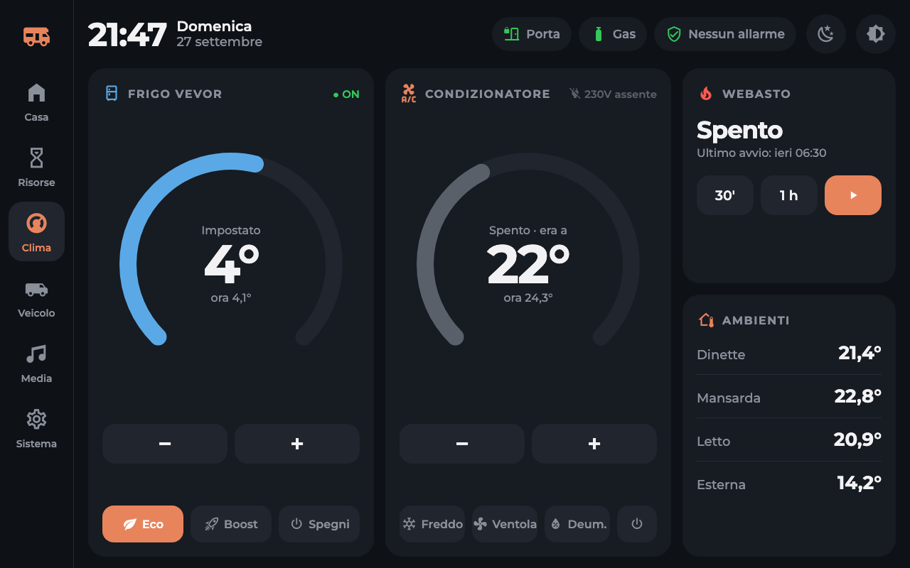 |
| *Resources: battery, water, gas, grey water, days left, 3-day chart* | *Climate: air conditioner, fridges, Webasto status* |
| 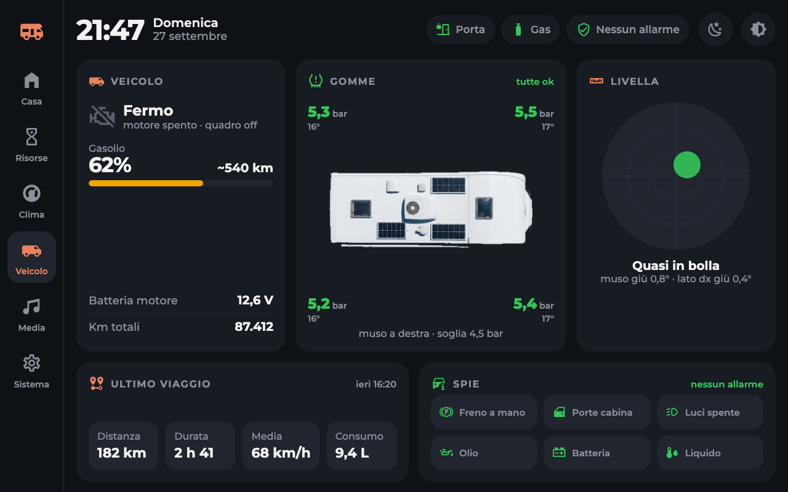 | 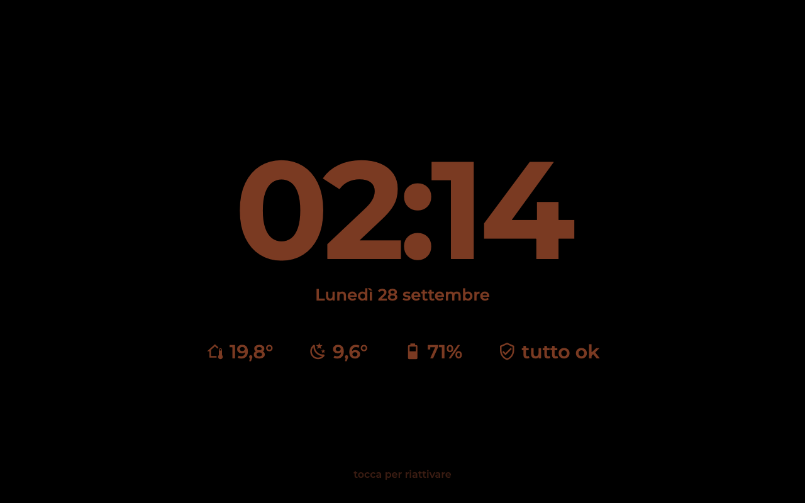 |
| *Vehicle: engine, tyres, spirit level, last trip, warning lights* | *Night screen: dim amber clock* |

## Switching the 12 V from the screen

The main switch cuts the lights, the 12 V sockets, the boiler, and in the author's van also the Raspberry Pi with Home Assistant and the router. So:

- **A PIN is asked** both to switch off and to switch on: a hand on the screen must not black out the camper.
- **Switching off takes 90 s**: the panel first calls a Home Assistant script (`script.camper_spegni_server`) that shuts down the server and the router cleanly, then cuts the line. A big **countdown** stays on screen.

| | |
|---|---|
| 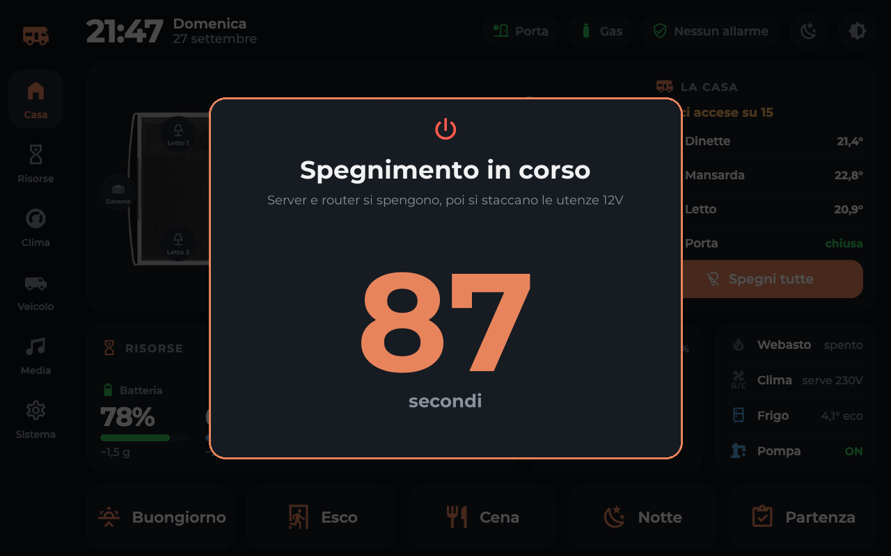 | 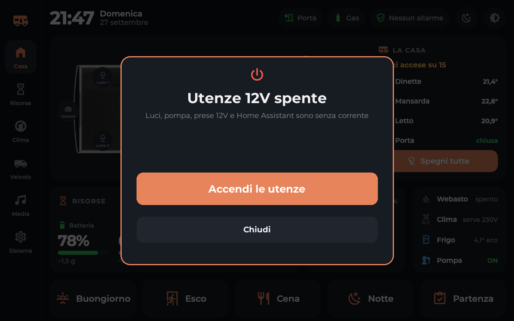 |
| *Countdown before the cut* | *With the 12 V off, any touch on a page shows this: "Accendi le utenze" opens the PIN pad* |

- The panel itself runs from **B2 before the main relay**, so it stays on with the loads off and can switch them back on.
- Fail-safe by design: no panel = relays at rest = everything on. A crash can never leave the van dark.

The **water pump** switch has no PIN: it is meant for repairs or a leak. Note that anything powered from the pump line (in the author's van, the ESP32 of the water tank sensor) goes off with it.

## Webasto (optional, not done here)

The Climate page shows the Webasto state from a Home Assistant entity (`binary_sensor.webasto_in_funzione`); it shows `--` if you don't have one.

Driving the heater from this panel was planned (relay 2 in parallel with the button of the MultiControl MC04/05 knob, status read from the spare plug behind it) but **was not finished on purpose**: a complete reverse engineering of the **Webasto MC04/05 panel** is under way and will be published as a separate repository, with an ESP32 that replaces the knob. This repo will link it when it is out.

## Engine and tyres: related projects

The vehicle page needs data that the DS-300 does not have. Both projects below feed it in the author's van:

- **[fiat-ducato-x250-wican](https://github.com/danderik88/fiat-ducato-x250-wican)**: decoded body-CAN of the Fiat Ducato X250 read with a WiCAN OBD dongle: engine running, RPM, coolant, fuel, odometer, doors, lights, parking brake, trip computer.
- **[usb-tpms-home-assistant](https://github.com/danderik88/usb-tpms-home-assistant)**: the cheap 433 MHz "USB TPMS for Android" kits read directly in Home Assistant: pressure and temperature of every tyre.

## Gotchas

- **No resistor in series.** A 1 kΩ "to be safe" between C.GEN and GND leaves about 1 V on the DS-300 relay coil: nothing clicks, and you think the pin is wrong. Use a straight wire (or the relay contact).
- **B2 and GND are mirrored.** A plug rotated by 180° swaps them and every measurement looks wrong. Check 12.7 V on pin 15 first.
- **No low-voltage cut-off any more.** The CBE panel switched the loads off below ~10 V; the DS-300 does not. Watch the battery in Home Assistant (the panel has a "battery below 30%" alarm).
- **Pin 11 (AGND) is not ground.** It is the common electrode in the grey tank (open circuit to pin 3). The probe needs a dedicated wire from pin 11 to the ADS1115 GND.
- **A broken Dupont looks like a dead chip.** If a relay doesn't respond, bridge IN to GND by hand: if it clicks, check the wire before blaming the PCF8574.
- **ESP32-C6 WiFi**: after a USB flash the C6 co-processor is not reset. If WiFi does not come back, remove power for a few seconds.
- **Check the build actually runs.** "OTA successful" is not enough: read `ESPHome version … compiled on <date>` in the logs.
- **Use a real 3 A supply** for the panel: the 10.1" backlight draws a lot at full brightness.

## Contributing

Tested this on another DS-300, found a pin that's different on your camper, or wired the probes this repo leaves out (fresh-water levels, D+, mains present)? Please share it. Open an issue or a pull request; see [CONTRIBUTING.md](CONTRIBUTING.md).

If this saved you a few evenings with a multimeter, you can [buy me a coffee](https://paypal.me/merighidaniel).

## Disclaimer

This is a **hobby project**, shared for information only, with **no warranty of any kind** (see [LICENSE](LICENSE)).

- Working on the electrical system of a vehicle is **at your own risk**. A short on B2 can melt wires or start a fire: fuse every wire that leaves +12 V, close to the source. The author accepts **no liability** for any damage to vehicles, equipment, data or people.
- The pinout comes from **one vehicle**. Measure yours before connecting anything.
- The original panel switched the loads off at low voltage; this setup does not. Look after your battery.
- Check that modifications are allowed by your local rules, insurance and warranty.
- CBE, Elnagh, Webasto, Fiat, Ducato, Guition, Espressif and Home Assistant are trademarks of their respective owners. This project is **not affiliated** with or endorsed by any of them. CBE manuals and diagrams are not redistributed here.

## How this was made

This project was done together with an AI coding agent ([Claude Code](https://claude.com/claude-code) by Anthropic). The agent searched the CBE documentation and the forums for the pinout, planned the measurements, wrote the firmware and the CAD scripts, flashed the panel over the network, and drafted this documentation.

Every measurement, every relay click and every wire was done by hand on the real van, and nothing is listed as working unless it was seen working there. If you find a mistake, please [open an issue](../../issues).

## License

[MIT](LICENSE)
